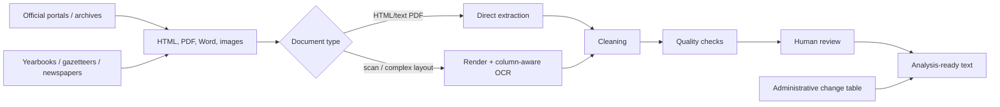

# China Prefecture-Level Government Work Report Corpus

[中文说明](README_zh.md)

This repository documents an independently constructed corpus of Chinese municipal government work reports (政府工作报告). The current inventory contains **295 municipal series across 31 provincial-level divisions**, including the four centrally administered municipalities. The core coverage is **2003-2026**; a small number of series begin earlier.

I started collecting these reports for empirical research. The project became larger than the original paper because the main difficulty was not downloading recent webpages. It was reconstructing older city-year records from incomplete official archives, historical yearbooks, scanned documents, and changing administrative units.


## Snapshot

- **295** municipal series
- **31** provincial-level divisions
- **295/295** series manually checked in the current inventory
- **6,716** city-year entries marked available within the recorded series
- **32** explicit gaps inside those recorded series
- **64** prefecture-level administrative changes tracked for 2000-2018
- current inventory span: **2000-2026**

The counts above describe this project's current inventory. They are not a claim that every report came from a municipal website, and they are not a claim that this is the largest collection among all proprietary datasets.

## Why these reports are useful

At the municipal level, a government work report is typically delivered by the mayor at the annual session of the local people's congress. It reviews government work from the previous year and sets out priorities, targets, and major tasks for the new year. This recurring structure makes the reports useful for studying policy attention, targets, local economic strategy, environmental policy, industrial policy, and other questions that require comparable city-level text over time.

The institutional setting matters. Under China's Constitution, local people's congresses are local organs of state power, local governments are their executive organs and local administrative organs, and local governments report their work to the people's congress at the corresponding level. The Local Organization Law also provides that county-level-and-above local people's congresses hear and deliberate the work reports of their governments. See [`docs/institutional_background.md`](docs/institutional_background.md).

## What made the collection difficult

### 1. Official online archives are often shorter than the historical record

A current municipal portal may contain only recent reports. Older files can disappear after site redesigns or data migration. For the final corpus, a missing webpage therefore did not automatically mean a missing report.

The clearest example is **Laibin, Guangxi**. In an official 2025 reply to a research inquiry, the municipal authority stated that, because of website-system data migration, it could not provide electronic copies of government work reports from 2014 or earlier and directed users to the municipal portal for 2015 onward. I nevertheless recovered the **2005-2014** reports from *Laibin Yearbook* volumes. The 2010 report is used as the main archive-recovery case in this repository.

See [`docs/case_studies/laibin_archive_recovery.md`](docs/case_studies/laibin_archive_recovery.md).

### 2. Historical PDFs are not clean text files

Older reports appear as HTML, Word files, text PDFs, scanned PDFs, and yearbook pages. Multi-column Chinese layouts are particularly easy to break: ordinary PDF extraction can interleave columns, merge unrelated material, or destroy reading order.

The 2010 **Linyi** report in *Linyi Yearbook 2011* is a representative two-column example. The public code includes a cleaned version of the two/three-column OCR routines that were used in the working notebooks.

See [`docs/case_studies/linyi_multicolumn.md`](docs/case_studies/linyi_multicolumn.md).

### 3. Some cities are easy - and should stay easy

When a government archive provides a stable index of HTML reports, collection can be almost fully automated: discover report links, visit each page, extract the article body, normalize the text, and save by city and year. The repository includes a generic HTML collector for this case, but **does not publish the project author's city-by-city source-link inventory**.

See [`docs/case_studies/standard_html_collection.md`](docs/case_studies/standard_html_collection.md).

### 4. City-year coverage changes with administrative geography

An absent city-year is not always a missing document. Cities have been established, renamed, merged, and abolished during the sample period. The project separately tracks prefecture-level administrative changes so that a nonexistent city-year is not mechanically treated as a missing report.

The public administrative-change file contains **64** records from 2000-2018.


## Repository contents

```text
.
├── README.md
├── README_zh.md
├── DATA_AVAILABILITY.md
├── CITATION.cff
├── LICENSE
├── requirements.txt
├── requirements-ocr.txt
│
├── metadata/
│   ├── city_coverage.csv
│   ├── city_year_coverage.csv
│   ├── prefecture_changes_2000_2018.csv
│   ├── reference_sources.csv
│   ├── data_dictionary.md
│   └── normalization_notes.md
│
├── docs/
│   ├── institutional_background.md
│   ├── methodology.md
│   ├── quality_control.md
│   ├── research_context.md
│   ├── code_provenance.md
│   └── case_studies/
│       ├── laibin_archive_recovery.md
│       ├── linyi_multicolumn.md
│       └── standard_html_collection.md
│
├── src/
│   ├── collection/
│   ├── metadata/
│   ├── processing/
│   ├── review/
│   └── validation/
│
├── notebooks/
│   ├── 01_build_public_metadata.ipynb
│   └── 02_processing_demo.ipynb
│
├── examples/
└── figures/
```

## Processing workflow



The working pipeline includes HTML/PDF extraction, scan handling, column-aware OCR, page-break and punctuation repair, header/footer removal, encoding normalization, sentence segmentation, and manual review of abnormal outputs.

An optional LLM-assisted review utility is included under `src/review/`. It **does not overwrite text automatically**. It prepares suspicious OCR spans for human-in-the-loop review. This utility was formalized while packaging the repository; it should not be read as a claim that the same script was used on every historical file.

## Public data and private provenance

This repository is intentionally **not** a dump of the full corpus.

Public:
- city-level and city-year coverage metadata;
- prefecture-level administrative-change metadata;
- reusable collection / processing / validation code;
- short illustrative excerpts.

Kept private:
- the city-by-city source-link inventory;
- full raw yearbook/newspaper scans;
- the full text corpus in this application-oriented release.

The source-link inventory is part of the maintenance workflow: links were located and checked city by city, and keeping them private makes it easier to maintain the corpus without turning the repository into a directory of unstable source URLs. Redistribution conditions also differ across historical archives.

See [`DATA_AVAILABILITY.md`](DATA_AVAILABILITY.md).

## Reproducibility

The original project grew through many working notebooks and one-off scripts. The code in `src/` is a cleaned, reusable version of those routines. Absolute local paths and city-specific URLs were removed.

Minimal install:

```bash
pip install -r requirements.txt
```

OCR dependencies are separated because PaddleOCR / PaddlePaddle installation depends on the machine:

```bash
pip install -r requirements-ocr.txt
```

The two notebooks show how to rebuild public metadata from the private workbook and how the processing / QC modules fit together.

## Research context

Government work reports have already been used in research on local policy choice, growth targets, environmental outcomes, government disclosure, and leadership rotation. A few examples are collected in [`docs/research_context.md`](docs/research_context.md). The purpose of this repository is not to claim that text analysis of work reports is new; the contribution is the data-construction work required to make longer city series usable.

## Status

**v1.0 - application release.**

Collection and the first full city-level verification pass are complete. Future updates will focus on adding new annual reports, correcting residual OCR errors, and improving documentation for selected archive-recovery cases.

## Author

**Yuankui Wang**

Independent data construction project.
