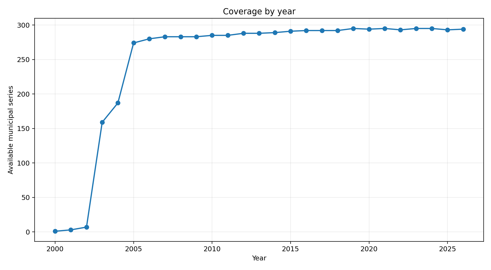
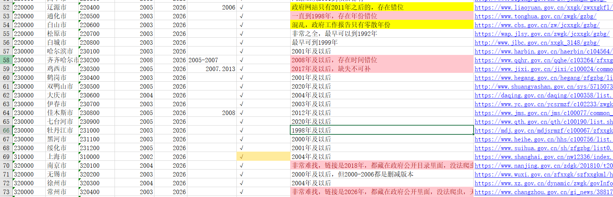
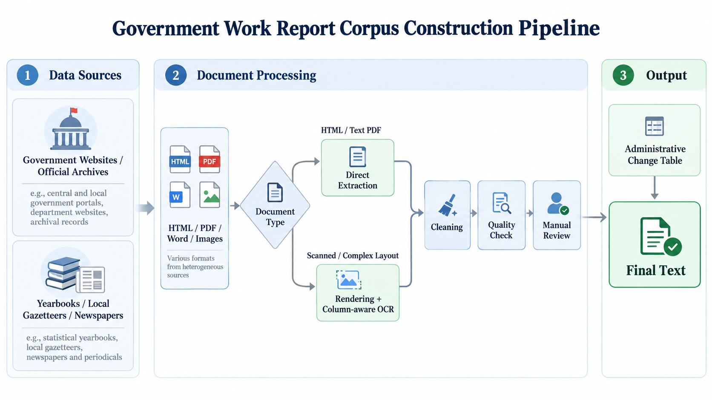
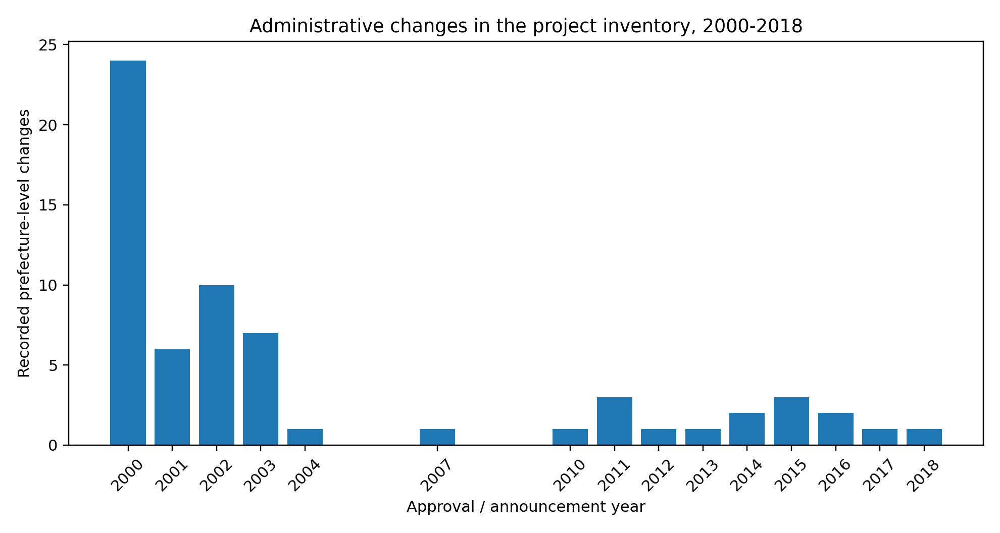
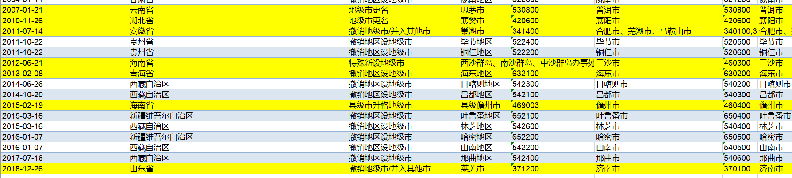

# Chinese Prefecture-Level Government Work Report Corpus (2005–2026)

[中文 README](README_zh.md)

I started this project for my master's thesis. In practice, web scraping turned out to be the easiest part of the collection process, not the hardest.

Recent government work reports are not particularly difficult to find. Some municipal websites are organized well enough that `requests + BeautifulSoup` can collect most of the relevant years. But many sites do not maintain long historical runs. Old pages disappear, government websites are redesigned, PDF and Word files are mixed together, yearbooks and local gazetteers survive only as scans, two- and three-column layouts break the reading order, and even the year attached to the same report can be inconsistent. A report delivered in January 2026, for example, may still appear under a page title calling it the 2025 Government Work Report.

There is another complication: cities themselves change. Prefectures are converted into cities, cities are renamed or newly established, and some are merged or abolished. Those changes directly affect whether a particular city-year should exist in the first place.

So what began as "collect the data I need for my thesis" gradually became a data project of its own.

I treat **2005–2026** as the main coverage window. The master inventory currently contains **295 city series across all 31 provincial-level divisions in mainland China**, including the four centrally administered municipalities. Within 2005–2026, I currently have **6,359 available city-years**, with **32 explicit gaps** inside the recorded coverage intervals. Earlier material is also noted in the metadata. Coverage remains fairly good back to 2003; before that, the problem is increasingly not just whether a report can be found online, but whether the relevant local gazetteers and archival materials exist in usable form at all.



## Author

**Yuankui Wang**  
**Hunan University**  
**Current email: yuankuiw@hnu.edu.cn**

## Example structure

<p align="center">
  
</p>

<p align="center">
  <em>Figure 2. Example of the city-level coverage inventory.</em>
</p>

## Why government work reports?

At the municipal level, a government work report is usually delivered by the mayor at the annual session of the local people's congress.

In simple terms, it does two things: it reviews what the government did in the previous year, and it sets out what it plans to do in the coming year.

That makes the reports unusually dense policy documents. GDP and fiscal targets, industrial policy, major projects, transport, urban construction, energy, environmental policy, employment, education, healthcare, housing, social security, and even local risks or major incidents can all appear in a single report.

More importantly, these are not one-off news releases. They are a recurring, institutionalized form of text that appears in roughly comparable form every year. That is what makes them useful for text-based economic research: the same city can be followed over time, while cities within the same province can also be compared using a relatively stable type of document.

I am also applying to Economics PhD programs in North America. My current working paper only uses data from 2015–2024, but I still collected the earlier 2005–2015 material and the later 2025–2026 reports. I expect to keep extending the series. Even outside a specific empirical paper, I think there is value in being able to look back and see what a local government said it was doing in a particular year.

A more detailed discussion of the institutional background is in [`docs/institutional_background.md`](docs/institutional_background.md).

## How this project differs from existing public datasets

I asked this question myself before spending a large amount of time filling gaps, so I looked through several existing datasets and used them for cross-checking.

They are useful, and I do not think the point is to dismiss what other people have built. The problem for my own research was more specific: **a large number of files is not the same thing as a longitudinal city panel that is ready to use.** Many public collections are designed primarily as data products rather than around the needs of a particular empirical project. In my own spot checks, OCR noise, watermarks, typos, missing years, and occasional mismatches were common enough that I could not simply treat the text as analysis-ready. Some of these problems are much easier to repair now with modern language models, but the model still needs a reliable source document and a way to verify the correction.

The entries below are based on the public descriptions that I rechecked in October 2026. Their scopes, administrative levels, and historical conventions are not identical, so this is not meant as a simple ranking by file count.

| Dataset / source | Scope in the public description | What is still different from what I needed |
| --- | --- | --- |
| [MacroData / 马克数据网](https://www.macrodatas.cn/) | The site currently lists prefecture-level government work reports covering roughly 2002–2025. Its county-level collection is described as covering 1998–2025, 2,737 counties/districts, and 32,853 records. | It is useful as a reference and for cross-checking. In my own checks of older years, however, missing years, incomplete bodies, and OCR that could not be used directly were common. The public description focuses mainly on text organization, segmentation, and word frequencies; it does not document the kind of yearbook/gazetteer recovery, scanned multi-column PDF reconstruction, historical web recovery, or administrative-boundary reconciliation that I needed. |
| [TextData.cn](https://textdata.cn/blog/2023-12-17-gov-anual-report-dataset/) | Its municipal collection is described as covering 2003–2024 with 6,204 reports, together with central and provincial reports. | It is convenient for quick text experiments or word-frequency work. Its purpose, however, is not to trace a missing year city by city and then recover that specific report from a local yearbook, gazetteer, or newspaper. |
| [lawtext/gov](https://github.com/lawtext/gov) | A public GitHub collection of government work reports, Five-Year Plans, and related policy texts. | One thing I appreciate about this project is that the README explicitly acknowledges that some texts may still contain garbling, abridgment, or incomplete content. "There is a TXT file online" and "this observation is ready to enter an empirical dataset" are not the same thing. |
| [DataSeed county-level government work report text indicators](https://www.cndataseed.com/data-detail/3759?database_id=866) | The public description gives 2000–2025 coverage, about 2,700 counties/districts, and 34,132 records, with many text indicators already constructed. | County-level data are valuable, and the cross-section is much larger than at the prefecture level. But if "2,700 counties × 26 years" is used only as a rough upper bound, the published record count still implies a fairly sparse long panel. That is only an intuitive comparison, since administrative changes have not been netted out. The public description also emphasizes final text indicators rather than recovery of old PDFs, multi-column OCR, or historical archive gaps. |

So I did not set out to build the largest possible database across every administrative level. My target is narrower: **make the prefecture-level government work report series for 2005–2026 as complete as I reasonably can, and understand what happened in every unusual city-year.**

That matters for the later text analysis. A TXT file with a lot of words in it is not automatically a valid observation. The year may be wrong, the file may be only an abridged version, the left and right columns may have been interleaved, or the city may not yet have existed in that administrative form.

## How long did it take?

Some cities were very easy. Beijing and Shanghai, and places such as Guangdong and Liaoning, have relatively well-organized archives or consolidated link pages, so a crawler can move through them with very little manual work. Where the official archive is regular, HTML collection can be close to fully automated. `requests`, `BeautifulSoup`, regular expressions, and a small amount of text cleaning are enough.

The difficult part is everywhere else.

Older reports may have disappeared completely from the current municipal website and have to be recovered from local yearbooks, gazetteers, people's congress materials, government gazettes, or local newspapers. Some PDFs look like ordinary PDFs but are actually page images. Good scans are manageable; older yearbooks may contain stains, faded text, skewed pages, headers, and footers. Two- and three-column layouts are worse: a human reader knows to read the left column before the right, but a generic PDF extractor can easily interleave them.

The year in the filename also cannot always be trusted. Most cities name the report by the meeting year, but there are genuine cases where the title uses the year mainly being reviewed. If I do not go back to the text and check the meeting date, an entire city-year series can be shifted by one year.

That is why the final workflow is semi-automated. Anything that can be automated reliably is automated; unusual cases are sent to manual review rather than forcing every city through the same script.

<p align="center">
  
</p>

<p align="center">
  <em>Figure 1. Government Work Report corpus construction pipeline.</em>
</p>

More details are in [`docs/methodology.md`](docs/methodology.md) and [`docs/quality_control.md`](docs/quality_control.md).

Below are two representative cases.

## Laibin: the website does not have it, but the report can still be recovered

Laibin is probably the clearest example of why I kept going beyond the current municipal website.

In 2025, a researcher contacted the Laibin municipal government because the 2011–2014 government work reports could no longer be found online. The official reply stated that, because of website-system data migration, electronic copies from 2014 and earlier were temporarily unavailable, while reports from 2015 onward could be found through the current municipal portal.

That does not mean the earlier reports no longer exist.

I later recovered the full **2005–2014** run from *Laibin Yearbook* / local gazetteer materials.

The 2010 report also happened to be a layout problem. The report begins only in the lower part of the first yearbook page, while material from the preceding article continues beside it. A direct PDF-to-text conversion therefore produces the wrong order and spacing. I ended up locating the page range, rendering the pages as images, splitting the columns, running OCR, cleaning the text, and checking it manually against the original page.

The case is documented in [`docs/case_studies/laibin_archive_recovery.md`](docs/case_studies/laibin_archive_recovery.md).

## Linyi as an example of two- and three-column PDF extraction

The 2010 government work report in *Linyi Yearbook 2011* is a typical two-column example.

A generic parser may read the first line of the left column, jump to the first line of the right column, and then return to the second line on the left. Page numbers and yearbook headers such as "Linyi Yearbook" can also be inserted into the report body.

My solution was fairly simple: render each page as an image, split it into two or three columns, OCR each region separately, and then merge the text in the actual reading order.

When I later organized the GitHub repository, I rewrote that part as [`src/processing/multicolumn_ocr.py`](src/processing/multicolumn_ocr.py).

A concrete example is in [`docs/case_studies/linyi_multicolumn.md`](docs/case_studies/linyi_multicolumn.md).

## Administrative divisions

This is another issue that became more important as the project developed.

China's prefecture-level administrative geography has continued to change after 2000. Prefectures have been converted into cities, leagues into cities, cities have been renamed or newly established, and some prefecture-level cities have been merged or abolished.

That means an empty city-year should not automatically be coded as `missing`. Sometimes the report is not missing at all; the city simply did not yet exist in the later prefecture-level form.

I therefore compiled **64 prefecture-level administrative changes from 2000–2018** and reconciled them against the report-coverage inventory.

These changes are also substantively interesting. In some cases, a prefecture-level reorganization reflects a change in how the state positions a city, or even a wider part of a province. Taken together, the 64 cases provide one way to think about the strategic logic behind changes at the prefecture level.



<p align="center">
  
</p>

<p align="center">
  <em>Figure 3. Example of prefecture-level administrative changes used for city-year reconciliation.</em>
</p>

The corresponding data are in [`metadata/prefecture_changes_2000_2018.csv`](metadata/prefecture_changes_2000_2018.csv).

## Text processing

The full process has involved a mix of HTML extraction, PDF extraction, scan detection, OCR, two- and three-column reconstruction, page-break repair, punctuation repair, header/footer removal, watermark and noise cleanup, encoding normalization, duplicate-report checks, year checks, character-count anomaly checks, and final manual review.

The original working notebooks were messy. A lot of the code was written for one particular city on one particular day: local absolute paths, temporary selectors, and ad hoc fixes that were edited again after the script had run.

The version under `src/` is the later, cleaned-up version. I pulled out the parts that were general enough to reuse, mainly so that the logic is understandable and can still be run again.

I also kept a small LLM-assisted review tool. I do not use it to rewrite an entire report automatically. Instead, it sends suspicious OCR spans together with their local context to the model, gets a suggested correction, and then I go back to the original page to decide whether the suggestion is actually right. Models are getting much better, but a plausible answer is not evidence that the original character on the page was really that character.

The main files are:

```text
metadata/city_coverage.csv
metadata/city_year_coverage.csv
metadata/prefecture_changes_2000_2018.csv
src/collection/html_archive.py
src/processing/multicolumn_ocr.py
src/processing/text_cleaning.py
src/validation/quality_checks.py
src/review/llm_assisted_review.py
```

## Why do I want to keep working on this?

The tools for text analysis are getting easier to use. Topic models, BERT, embeddings, classifiers, and now direct LLM-based reading no longer have the same technical barrier they did a few years ago.

Precisely because the tools are easier, I care more about what happens before the model: is this the full report? Is the year correct? Did OCR turn one policy term into another? Are two cities actually comparable? Is a city-year genuinely missing, or did the administrative unit not exist yet?

If those questions are not handled first, I do not think a more complicated model adds very much.

That is also why this project has grown far beyond the amount of data I originally needed for my master's thesis. Once the underlying corpus is reasonably solid, it can be used for much more than energy transition: policy attention, industrial policy, environmental regulation, fiscal pressure, the digital economy, employment, local competition, and many other questions.

I keep a short list of studies that use government work reports in [`docs/research_context.md`](docs/research_context.md).

## Current status

The first full round of collection and city-level checking is complete. My main analysis window is **2005–2026**. From here, the work is mostly annual maintenance: adding new reports and continuing to fix OCR, dating, or archival problems when I find them.

## Author

**Yuankui Wang**  
**Hunan University**  
**Current email: yuankuiw@hnu.edu.cn**  
**I hope to begin a PhD in Economics in North America in Fall 2027.**
