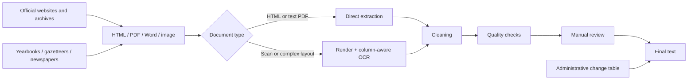

# China City-Level Government Work Report Corpus (2005–2026)

[中文说明](README_zh.md)

I started this project because I needed the data for my master's research. At the beginning I thought the hard part would be scraping government websites. It was not.

For recent years, some cities are actually very easy. A clean archive page, `requests + BeautifulSoup`, and a little text cleaning can get most of the job done. The real trouble starts when the series is pushed backward: old pages disappear, websites are rebuilt, PDFs are scans, yearbooks use two or three columns, the same report is named under different years, and sometimes the city itself did not yet exist in the same administrative form.

So what began as a collection task gradually became a corpus-construction project.

My main working period is **2005–2026**. The current inventory contains **295 city-level series across 31 mainland provincial-level divisions**, including the four centrally administered municipalities. Within 2005–2026, I currently have **6,359 available city-year reports**, with **32 explicit gaps inside the recorded series**. A small number of series also extend back before 2005.


## Why government work reports?

A municipal government work report is usually delivered by the mayor at the annual session of the local people's congress. In a very simple sense, it answers two questions: what did the government do last year, and what does it plan to do next year?

That makes the document unusually dense. A single report may discuss GDP and fiscal targets, industrial policy, infrastructure, energy, environmental regulation, employment, education, healthcare, housing, social policy, major projects, and local risks. More importantly for empirical work, the same type of document appears every year and can be linked to a specific city and institutional setting.

This is why I prefer it to ordinary government news or a collection of leaders' speeches. The wording changes, but the basic institutional function is stable enough to make long-run city-level text analysis possible.

A short institutional introduction is in [`docs/institutional_background.md`](docs/institutional_background.md).

## There are already datasets. Why collect them again?

I checked several existing datasets before and during this project. They are useful, and I have used them as reference points. But for my own research I kept running into the same problem: the number of files is not the same thing as a usable longitudinal corpus.

The comparison below is based on the providers' public descriptions available in October 2026. The scopes are not identical, so I do not treat the raw counts as a ranking.

| Dataset / source | Publicly described coverage | What I found useful, and what was still missing for my purpose |
| --- | --- | --- |
| [Mark Data / 马克数据网](https://www.macrodatas.cn/) | City government work reports are listed for roughly 2002–2025; a separate county collection reports 32,853 records for 2,737 counties over 1998–2025. | A useful starting point and cross-check. In my own spot checks of older municipal series, however, I still encountered missing years, partial text, and files that were not ready for direct text analysis. The public description does not explain a systematic recovery procedure for old yearbooks, scanned multi-column PDFs, or administrative-boundary reconciliation. |
| [CnOpenData](https://www.cnopendata.com/data/m/government/chinese-government-work-report.html) | The public page reports 8,472 city-level reports, with city coverage varying by place and extending as far back as 1983; it also reports 129 PDF files and 8,343 TXT files. | Much broader in stated historical span than my project. The count is not directly comparable because the city universe and historical definitions differ. What I needed, however, was a city-by-city series with explicit treatment of archive recovery, report-year normalization, scanned/multi-column documents, and administrative changes; those steps are not described on the public dataset page. |
| [TextData.cn](https://textdata.cn/blog/2023-12-17-gov-anual-report-dataset/) | 6,204 municipal reports for 2003–2024, plus central and provincial reports. | A convenient open reference corpus. It is especially useful for quick text work, but it is not designed around reconstructing individual missing city-years from archival sources. |
| [lawtext/gov](https://github.com/lawtext/gov) | Open GitHub collection of government work reports and planning documents. | Helpful for comparison because the repository itself notes that some texts may still contain errors, omissions, or abridged content. That is exactly the kind of problem I wanted to check city by city rather than assume away. |
| [DataSeed county government-work-report data](https://www.cndataseed.com/data-detail/3759?database_id=866) | 34,132 records covering about 2,700 counties over 2000–2025, with a large set of derived text indicators. | The county level is valuable and much broader cross-sectionally. But it is a different target. The reported record count also shows how sparse a national county-year corpus can become over a long period, and the public description focuses on the resulting indicators rather than document-level recovery of difficult PDFs and historical gaps. |

The point is not that these datasets are "bad." They solve somewhat different problems. My own target is narrower: **a high-coverage municipal series for 2005–2026 in which I know why a city-year is present, missing, renamed, newly created, or recovered from another source**.

That distinction became important very quickly. For text-as-data research, a long string in a TXT file is not automatically a valid observation. I still need to know whether it is the right report, the right year, complete enough to analyze, and comparable to the observations around it.

## What actually took time

Some cities are almost boring. Beijing, Shanghai, and a number of cities with well-organized portals can be collected with ordinary HTML requests. I kept a generic example in [`src/collection/html_archive.py`](src/collection/html_archive.py).

The difficult cities are where most of the time went.

An older report may survive only in a local yearbook, gazetteer, People's Congress material, or newspaper. A PDF may contain selectable text, or it may just be a stack of scanned images. Even when OCR works, a two-column page can come out in the wrong reading order. A report titled "2024 Government Work Report" may actually have been delivered in 2025, while another city follows the meeting year. Then there are places such as Laiwu, where the city itself disappears from the later panel after an administrative reorganization.

This is why I ended up using a semi-automated workflow rather than trying to force every city through one universal scraper.



More details are in [`docs/methodology.md`](docs/methodology.md) and [`docs/quality_control.md`](docs/quality_control.md).

## Laibin: the report existed, the website did not have it

Laibin, Guangxi, is probably my favorite example because it shows the difference between "not online" and "does not exist."

In 2025, a request was submitted to the municipal government for the 2011–2014 reports because they could no longer be found online. The official reply explained that, after website-system data migration, electronic versions from 2014 and earlier were temporarily unavailable, while reports from 2015 onward could be found on the current portal.

I later recovered the **2005–2014** series from *Laibin Yearbook* volumes.

The 2010 report is also a good layout example. The first page contains the beginning of the government work report next to material left over from the preceding article. A normal PDF-to-text tool does not understand that reading order. I therefore rendered the relevant pages, separated the columns, ran OCR, cleaned the result, and then checked the text again.

See [`docs/case_studies/laibin_archive_recovery.md`](docs/case_studies/laibin_archive_recovery.md).

## Linyi: a very normal page for a human, a bad page for a parser

The 2010 Linyi government work report in *Linyi Yearbook 2011* is a more conventional two-column example.

A person can read it without thinking. A parser may interleave the left and right columns, pull in page headers, and break a sentence into several unrelated lines. My working solution was simple: render the page, split the columns, OCR each region separately, and rebuild the reading order.

That logic later became [`src/processing/multicolumn_ocr.py`](src/processing/multicolumn_ocr.py).

See [`docs/case_studies/linyi_multicolumn.md`](docs/case_studies/linyi_multicolumn.md).

## Administrative changes are part of the data problem

Another thing I underestimated at the beginning was administrative geography.

The city map is not fixed over time. Since 2000 there have been prefecture-to-city conversions, newly established prefecture-level cities, renamings, mergers, and abolished cities. If I simply create a rectangular panel and label every blank cell as "missing," some of those missing values are wrong by construction.

I therefore separately checked **64 prefecture-level administrative changes between 2000 and 2018** and linked them back to the city-year inventory.


The corresponding table is [`metadata/prefecture_changes_2000_2018.csv`](metadata/prefecture_changes_2000_2018.csv).

## Processing and quality checks

The actual workflow accumulated gradually. It includes HTML extraction, PDF parsing, scan detection, OCR, two- and three-column extraction, page-break repair, punctuation cleanup, header/footer removal, noise removal, encoding normalization, duplicate checks, year checks, character-count checks, and manual review.

My original notebooks were not beautiful. Some had local paths, temporary selectors, or a fix written only for one city. That is normal for data collection. The code in `src/` is the part I later rewrote into cleaner and more reusable modules.

I also keep a small LLM-assisted review utility for suspicious OCR spans. I use it as a second pair of eyes, not as an automatic replacement for the source document. If a model proposes a correction, the correction still has to make sense against the page and its surrounding text.

The main files are:

```text
metadata/city_coverage.csv
metadata/city_year_coverage.csv
metadata/prefecture_changes_2000_2018.csv
src/collection/html_archive.py
src/processing/multicolumn_ocr.py
src/processing/text_cleaning.py
src/validation/quality_checks.py
src/review/llm_assisted_review.py
```

## Why I want to keep working on it

Text analysis is getting easier very quickly. Running a topic model, a classifier, an embedding model, or an LLM over thousands of documents is no longer the unusual part.

For me, that makes the upstream questions more important rather than less important. Is this really the full report? Is the year right? Did an OCR error turn one policy term into another? Is a blank city-year actually missing, or did the administrative unit not exist yet? If two cities look different in the regression, is that a policy difference or a data-construction difference?

That is also why this project became much larger than the dataset I originally needed for my thesis. Once the underlying corpus exists and is checked carefully, the same material can be used for research on policy attention, industrial policy, environmental regulation, energy transition, fiscal pressure, employment, digital economy, local competition, and many other questions.

Some papers that use government work reports in related ways are collected in [`docs/research_context.md`](docs/research_context.md).

## Current status

The first full round of collection and city-level checking is complete. My main analysis window is **2005–2026**, and I will continue to add new annual reports and correct residual OCR or archival issues when I find them.

## Author

**Yuankui Wang**
