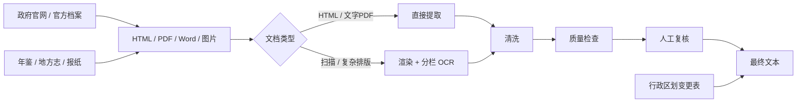

# 中国地级市政府工作报告语料库（2005–2026）

[English README](README.md)

这个项目一开始其实就是为了我的硕士论文。我当时觉得最麻烦的事情应该是爬虫，后来发现完全不是。

最近几年的政府工作报告其实没有那么难找。有些城市的网站整理得很好，一个 `requests + BeautifulSoup` 基本就能把主要年份抓下来。但只要把时间往前推，事情马上就变得很乱：旧网页失效、政府网站改版、PDF 和 Word 混在一起、年鉴只有扫描版、双栏和三栏顺序会错、同一份报告的年份命名还可能不一样。再往后还有一个更麻烦的问题——城市本身也会变，撤地设市、改名、新设、合并、撤销都会直接影响 city-year 到底应不应该存在。

所以最后它慢慢从“收一下毕业论文要用的数据”，变成了一个单独的数据项目。

我现在把 **2005–2026 年**作为主体区间。目前总表里有 **295 个城市序列，覆盖中国大陆 31 个省级行政区**，包括四个直辖市。只看 2005–2026 年，目前有 **6,359 个 available city-year**，在各城市已经记录的时间区间内还有 **32 个明确缺口**。另外少数城市可以继续往 2005 年以前追。


## 为什么是政府工作报告？

简单说，市级政府工作报告一般是市长在当地人民代表大会年度会议上作的报告。

它主要干两件事：第一，去年做了什么；第二，今年准备干什么。

所以这个文本的信息密度非常高。GDP、财政目标、产业政策、重大项目、交通、城建、能源、环保、就业、教育、医疗、住房、社会保障，甚至一些本地当年的风险和突发问题，都可能出现在一份报告里。

更重要的是，它不是一次性的新闻，而是一个城市基本每年都会重复出现的一类制度化文本。对我来说，这才是它真正适合做经济学文本研究的地方：同一个城市可以纵向追踪，不同城市之间也有相对稳定的文本类型可以比较。

更具体的制度背景放在 [`docs/institutional_background.md`](docs/institutional_background.md)。

## 市面上不是已经有了吗？为什么还要自己再收一遍？

这个问题我自己一开始也问过，所以在真正花大量时间补数据之前，我其实看过不少现成数据库，也拿它们交叉核过。

它们当然有价值，我也不会说别人做的东西“没用”。但对我自己的研究来说，一个很快就会碰到的问题是：**文件数量多，不等于已经形成了一套可以直接做长期城市面板的文本数据。**

下面这些是我在 2026 年 10 月重新核过的公开介绍。因为各家的研究对象、行政层级和历史口径并不完全一样，所以这里不是简单比谁的数字大。

| 数据库 / 数据源 | 公开介绍里的范围 | 对我这个项目来说还差在哪里 |
| --- | --- | --- |
| [马克数据网](https://www.macrodatas.cn/) | 网站目前列有约 2002–2025 年的地级市政府工作报告；另外县域版公开介绍为 1998–2025 年、2737 个区县、32,853 条记录。 | 很适合拿来做参考和交叉核对。但我自己抽查老年份的时候，仍然碰到过缺年、正文不完整、识别结果不能直接用的情况。它的公开说明主要讲文本整理、分词和词频，没有详细说明年鉴恢复、扫描双栏 PDF 识别、历史网页补档、行政区划衔接这些步骤。 |
| [CnOpenData](https://www.cnopendata.com/data/m/government/chinese-government-work-report.html) | 公开页面目前写的是 8,472 份市级报告，不同城市起始年份不一样，最早可到 1983；其中还列出了 129 份 PDF 和 8,343 份 TXT。 | 它的名义时间跨度比我这个项目更长，总量也不能和我直接横比，因为城市口径和历史单位可能不同。但我自己真正需要的是：某一个 city-year 为什么有、为什么没有、老扫描件怎么恢复、报告年份怎么统一、行政区划变化怎么处理。公开页面没有展开这些过程。 |
| [TextData.cn](https://textdata.cn/blog/2023-12-17-gov-anual-report-dataset/) | 市级部分公开介绍为 2003–2024 年，共 6,204 份，同时还有中央和省级报告。 | 作为公开文本集很方便，做快速词频或文本实验完全够用；但它的目标并不是逐城市追踪某个缺失年份，再去地方年鉴、市志、报纸里把那个年份补回来。 |
| [lawtext/gov](https://github.com/lawtext/gov) | GitHub 上公开的政府工作报告、五年规划等文本集合。 | 我觉得这个项目反而很诚实：README 直接写了部分文本仍可能存在乱码、删节或不完整。对我来说，这正好说明“网页上有一份 TXT”跟“这个 observation 已经可以直接放进研究”不是一回事。 |
| [DataSeed 区县政府工作报告文本指标数据](https://www.cndataseed.com/data-detail/3759?database_id=866) | 公开介绍是 2000–2025 年、约 2700 个区县、34,132 条记录，而且已经做了大量文本指标。 | 县级本身是很有价值的方向，而且横截面比地级市大得多。但如果拿“2700 个区县 × 26 年”当一个非常粗的上限来看，公开的有效记录显然仍然是一个比较稀疏的长面板——当然这里还没有扣除行政区划变化，所以只能当直观比较。公开说明的重点也主要在最终指标，而不是老 PDF、双栏 OCR 和历史缺档怎么修。 |

所以我最后没有想做一个“什么层级都有”的最大数据库。我给自己定的目标反而比较窄：**先把 2005–2026 年地级层面的政府工作报告尽可能做完整，而且我自己要知道每一个异常 city-year 是怎么回事。**

这对后面的文本分析很重要。TXT 里有一大段字，不代表它天然就是一个有效 observation。它可能年份错了，可能只有摘要，可能左右栏串了，也可能这个城市当年根本还不存在。

## 真正花时间的是什么？

有些城市其实非常省事。北京、上海，以及一些整理得比较好的地方，官网档案很规整，HTML 页面甚至可以几乎全自动抓。这个部分本身没什么神秘的，`requests`、`BeautifulSoup`、正则和一点文本清洗就够了。

麻烦的是另一批城市。

旧报告可能已经完全不在现在的市政府网站里，只能去地方年鉴、市志、人大资料、政府公报或者地方报纸找。有些 PDF 看起来是 PDF，实际上每一页都是图片。扫描质量好的还好，老一点的年鉴会有污点、淡字、倾斜、页眉页脚。双栏和三栏更麻烦：人眼一秒钟就知道先读左边再读右边，但普通 PDF 提取工具很容易把两栏交叉起来。

年份也不能完全相信文件名。绝大多数地方按开会年份命名，但确实存在把主要回顾年份写进标题的情况。如果不回到正文看会议日期，city-year 很容易整体错一格。

所以我最后做的是 semi-automated。能稳定自动化的就自动化，碰到异常就转人工，而不是强行让所有城市走同一条脚本。



具体的方法放在 [`docs/methodology.md`](docs/methodology.md) 和 [`docs/quality_control.md`](docs/quality_control.md)。

## 来宾：官网没有，不代表报告不存在

来宾是我现在觉得最能解释这个项目为什么要做的一个案例。

2025 年，有研究者因为网上找不到 2011–2014 年的政府工作报告，直接向来宾市政府申请查询。官方回复说，因为网站系统数据迁移，2014 年及以前的电子版暂时无法提供，2015 年以后可以在现在的门户网站查询。

但这并不代表 2014 年以前的报告真的没了。

我后来从《来宾年鉴》里把 **2005–2014 年**这一段全部补了回来。

2010 年这一份还刚好碰上排版问题。年鉴第一页下半部分才开始进入政府工作报告，旁边又接着上一篇文章，直接做 PDF-to-text，顺序和空格都会乱。所以这份最后还是走了页面定位、图片渲染、分栏、OCR、清洗，再人工对一遍。

案例放在 [`docs/case_studies/laibin_archive_recovery.md`](docs/case_studies/laibin_archive_recovery.md)。

## 临沂：人看着很正常，机器不一定这么想

《临沂年鉴 2011》里的 2010 年政府工作报告就是很典型的双栏。

人看起来完全没问题，但普通解析器可能把左栏第一行接到右栏第一行，再回来读左栏第二行；页码和“临沂年鉴”这种页眉也会一起混进正文。

我当时的办法其实很朴素：先把页面转成图片，再按两栏或者三栏切，分别 OCR，最后按照真正的阅读顺序合并。

后来整理 GitHub 的时候，我把这部分重新写成了 [`src/processing/multicolumn_ocr.py`](src/processing/multicolumn_ocr.py)。

具体例子见 [`docs/case_studies/linyi_multicolumn.md`](docs/case_studies/linyi_multicolumn.md)。

## 行政区划也是数据清洗的一部分

这个问题也是我做到后面才越来越重视。

2000 年以后，中国地级层面的行政区划仍然在变化。撤地设市、撤盟设市、改名、新设地级市、合并、撤销都真实发生过。

这意味着看到一个 city-year 是空的，不能直接写 `missing`。有时候不是报告没找到，而是那个城市在当年根本还没有以之后的地级市形式存在。

所以我另外整理了 **64 条 2000–2018 年地级层面的行政区划变化**，再回头和报告覆盖表对。


对应数据在 [`metadata/prefecture_changes_2000_2018.csv`](metadata/prefecture_changes_2000_2018.csv)。

## 文本到底怎么处理？

整个过程中实际用过的东西很多：HTML extraction、PDF extraction、scan detection、OCR、双栏/三栏识别、page-break repair、标点修复、页眉页脚清理、噪声和水印处理、编码统一、重复报告检查、年份检查、字符数异常检查，最后再人工复核。

原来的工作 notebook 其实挺乱的，这个没必要装。很多代码就是某一天为了某个城市临时写的，本地绝对路径、临时 selector、跑完以后再接着改。

现在 `src/` 里面的是我后来重新整理过的版本：把比较通用的逻辑拿出来，让代码至少能看懂、能重复用。

我也留了一个 LLM-assisted review 的小工具。我的用法不是“让大模型自动修全文”，而是把很可疑的 OCR 片段连着上下文一起拿出来，让模型给一个建议，然后再回到原页判断。毕竟现在模型越来越强，但它说得像真的，不代表原文真的就是那个字。

主要文件是：

```text
metadata/city_coverage.csv
metadata/city_year_coverage.csv
metadata/prefecture_changes_2000_2018.csv
src/collection/html_archive.py
src/processing/multicolumn_ocr.py
src/processing/text_cleaning.py
src/validation/quality_checks.py
src/review/llm_assisted_review.py
```

## 为什么我还想继续做这个？

现在做文本分析的工具越来越简单。topic model、BERT、embedding、classifier，包括现在直接让大模型读文本，都已经不像几年前那样有什么特别高的门槛。

但也正因为工具越来越容易，我反而更在意前面的东西：这是不是完整报告？年份对不对？OCR 有没有把一个政策词认成另一个词？两个城市到底能不能直接比？某个 city-year 是真的缺失，还是行政单位当时就不存在？

如果这些问题前面没处理好，后面模型再复杂，我觉得意义也有限。

这也是为什么这个项目最后的工作量已经远超过我最开始毕业论文需要的数据。数据一旦比较扎实，它以后不只是能做能源转型，也可以继续做政策注意力、产业政策、环保监管、财政压力、数字经济、就业、地方竞争等等很多东西。

我把一些已经使用政府工作报告做研究的文章整理在 [`docs/research_context.md`](docs/research_context.md)。

## 目前进度

第一轮完整收集和城市层面的核对已经做完。我的主体分析区间是 **2005–2026 年**。后面主要就是每年继续补新的报告，以及发现 OCR、年份或者历史档案问题的时候继续修。

## Author

**Yuankui Wang**
